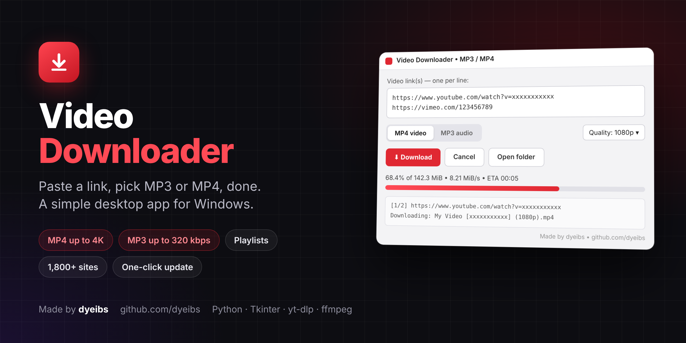

# Video Downloader

Paste a link, pick **MP3** or **MP4**, done. A simple Windows desktop app for downloading videos and audio from YouTube and 1,800+ other sites.

## Features
- **MP4** up to 4K, saved as H.264/AAC so it plays everywhere (Windows, phones, CapCut)
- **MP3** at 128–320 kbps
- Multiple links at once and whole playlists
- Progress bar with speed and ETA, plus a Cancel button
- One-click **Update yt-dlp** for when a site changes

## Download
Get `Video Downloader.exe` from the [Releases](../../releases) page and run it.
On first launch it downloads `yt-dlp.exe` and `ffmpeg.exe` into a `tools` folder next to the exe.

> Windows may show "Windows protected your PC" because the exe isn't signed. Click **More info → Run anyway**.

For full YouTube support, install Deno once:
```
winget install DenoLand.Deno
```

## Run from source
```
python downloader.py
```
Needs Python 3.9+ (tkinter is included with the Windows installer).

## Build the exe
```
pip install pyinstaller
pyinstaller --onefile --windowed --name "Video Downloader" downloader.py
```

## Built with
Python · Tkinter · [yt-dlp](https://github.com/yt-dlp/yt-dlp) · [ffmpeg](https://ffmpeg.org)

Only download videos you own or have permission to save.

---
Made by [dyeibs](https://github.com/dyeibs)
